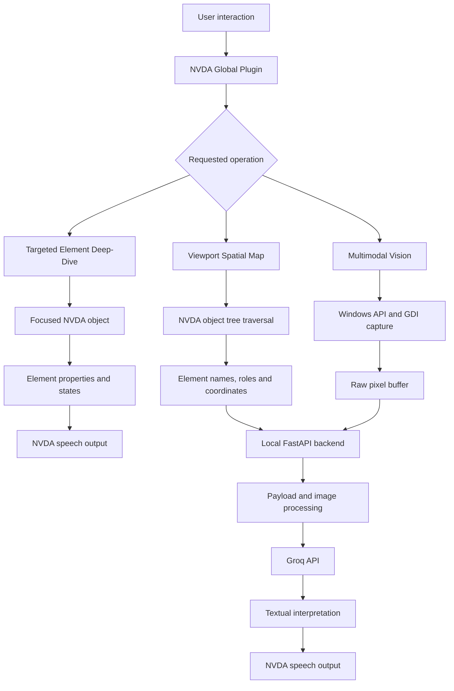

# Interpret

### Making visual interfaces more accessible through screen readers and multimodal AI

**Interpret** is an open-source visual accessibility layer for [NVDA (NonVisual Desktop Access)](https://www.nvaccess.org/), designed to help screen-reader users understand complex graphical interfaces that traditional accessibility metadata may not fully describe.

Modern applications increasingly rely on charts, dashboards, custom-rendered controls, and other visual components. When these elements expose incomplete or missing accessibility information, screen readers can struggle to communicate what is on the screen.

Interpret addresses this gap through a hybrid approach: it combines information from the native Windows accessibility tree with multimodal AI vision analysis, turning interface structure and visual content into concise, speech-friendly descriptions.

Rather than relying on visual AI for every interaction, Interpret uses the information already available through the accessibility layer wherever possible, reserving image analysis for situations where visual context adds value.

---

## The problem

Screen readers such as NVDA rely heavily on accessibility information exposed by an application and its operating system. On Windows, this information can be accessed through interfaces such as Microsoft UI Automation and MSAA.

When applications implement these interfaces properly, screen readers can identify controls, read labels, communicate states, and provide a navigable representation of the interface.

However, modern graphical interfaces do not always expose their content in a sufficiently accessible way.

Consider a few examples:

- **Charts and graphs:** A screen reader may announce that a graphic exists without communicating the data, trends, axes, or relationships it represents.
- **Custom-rendered interfaces:** Components drawn using canvas-based frameworks or custom graphics may expose little or no useful accessibility metadata.
- **Complex dashboards:** Even when individual controls are accessible, understanding how they are arranged and how different sections relate to one another can be difficult.
- **Incomplete element descriptions:** A control may be technically detectable but have an unhelpful name, missing state information, or insufficient context.

This creates a distinction between detecting an interface element and actually understanding what it communicates.

Interpret explores how native accessibility information and multimodal AI can work together to bridge that gap.

## The approach

Interpret uses three complementary mechanisms to interpret an interface:

1. **Structural understanding:** Extract information from the native accessibility tree to build a spatial overview of the active application.
2. **Focused element interpretation:** Retrieve the properties and state of the currently focused interface element.
3. **Visual interpretation:** Capture the active application window and use multimodal AI to describe visual content that cannot be adequately understood through accessibility metadata alone.

Each mechanism serves a different purpose. Structural information provides context, focused-element inspection supports immediate interaction, and visual analysis helps interpret graphical content.

The resulting descriptions are designed to be concise and suitable for speech output through NVDA.

---

## Core features

### 1. Viewport Spatial Map

**Shortcut:** `NVDA + Shift + I`

Navigating an unfamiliar interface can be difficult when a screen reader announces individual controls without communicating how they fit together.

Viewport Spatial Map provides a higher-level overview of the active foreground application.

**How it works:**

1. Interpret identifies the active NVDA object and begins traversing its accessible object hierarchy.
2. It recursively inspects child elements up to a controlled depth.
3. For each relevant element, it extracts available information such as:
   - Accessible name
   - Element role
   - Screen location and bounding-box coordinates
4. The collected information is serialized into a JSON payload.
5. The local backend processes the hierarchy and sends a structured representation to a language model.
6. The generated response describes the overall interface, its major components, and useful spatial or keyboard-navigation context.

The goal is to transform a collection of individual accessibility objects into a more coherent description of the current viewport.

Instead of hearing a disconnected sequence of controls, users can receive an overview of the interface and how its major sections are arranged.

### 2. Targeted Element Deep-Dive

**Shortcut:** `NVDA + Shift + O`

Sometimes the most useful information is not about the entire interface, but about the particular element currently in focus.

Targeted Element Deep-Dive retrieves information about the focused NVDA object and communicates its properties through NVDA's speech interface.

It uses `api.getFocusObject()` to retrieve the focused object and inspects relevant attributes, including:

- Accessible name
- Role
- Current value, where available
- Description
- Interaction states, such as focused, checked, or disabled

The information is assembled into a concise spoken description.

Unlike the spatial map and visual interpretation features, this operation does not need to send a screenshot to an external AI service. It uses the accessibility information already available to NVDA.

This makes focused-element inspection a lightweight way to obtain additional context during ordinary navigation.

### 3. Multimodal Vision for Graphics

**Shortcut:** `NVDA + Shift + G`

Some visual information cannot be recovered from the accessibility tree alone.

Multimodal Vision is designed for these situations, including unlabelled graphics, charts, dashboards, and custom visual controls.

**How it works:**

1. Interpret identifies the active foreground application window using the Windows API.
2. It retrieves the window's screen coordinates through `GetWindowRect()`.
3. Native Windows GDI functions capture the window's visual contents.
4. The captured pixel buffer is encoded and transferred to the local backend.
5. The backend reconstructs the image using Pillow, resizes it where necessary, and converts it into JPEG format.
6. The processed image is sent to a multimodal model through the Groq API.
7. The model returns a concise textual description of the visual content.
8. Interpret communicates the result through NVDA.

The vision prompt is designed to produce short, speech-friendly descriptions rather than lengthy visual narratives. For charts and graphs, this includes relevant axes, trends, relationships, and visible states where they can be identified.

The feature allows visual information to supplement the accessibility metadata exposed by an application.

---

## Architecture

Interpret follows a lightweight client-server architecture.

The NVDA plugin is responsible for interacting with NVDA and Windows. A separate local FastAPI backend handles image processing, payload preparation, and communication with external AI services.

This separation was an important design decision: image-processing dependencies and API-related functionality can remain outside NVDA's Python environment, reducing the amount of third-party software the plugin itself needs.

### System overview



### 1. NVDA client

The client is implemented as an NVDA Global Plugin.

Its responsibilities include:

- Registering keyboard shortcuts.
- Responding to user-triggered accessibility operations.
- Accessing NVDA's object hierarchy and focused element.
- Retrieving accessible properties and screen coordinates.
- Capturing the active application window.
- Communicating with the local backend.
- Delivering descriptions through NVDA's speech interface.

A key implementation decision was to avoid bundling image-processing libraries into the NVDA plugin.

Instead, screen capture is implemented using Python's `ctypes` interface to native Windows APIs, including `user32.dll` and `gdi32.dll`.

This allows the client to obtain raw pixel data without requiring a third-party image-processing dependency inside NVDA's Python environment.

### 2. Local FastAPI backend

The backend runs separately from NVDA and exposes HTTP endpoints for the plugin.

It is responsible for:

- Receiving structured accessibility-tree data.
- Receiving raw image data and associated dimensions.
- Reconstructing and processing captured images.
- Resizing and encoding images before inference.
- Constructing prompts for the relevant AI tasks.
- Sending requests to the Groq API.
- Returning textual descriptions to the client.

The backend uses Pillow for image reconstruction and processing, keeping those dependencies isolated from the NVDA plugin.

### 3. AI inference

Interpret uses Groq's OpenAI-compatible API for language-model inference.

The two AI-assisted operations have different requirements:

| Operation | Input | Output |
|---|---|---|
| Viewport Spatial Map | Structured accessibility-tree information | Semantic overview of the interface |
| Multimodal Vision | Processed screenshot | Description of graphical content |

The prompts are designed around the needs of a screen-reader user. Responses prioritize relevant information, concise explanations, and actionable context over generic image descriptions.

Targeted Element Deep-Dive does not require an AI inference request.

---

## Technology stack

| Component | Technology | Purpose |
|---|---|---|
| Screen reader integration | NVDA Python API | Global plugin, object access, focus handling, speech output |
| Windows integration | Python `ctypes`, `user32.dll`, `gdi32.dll` | Window identification and native screen capture |
| Backend framework | FastAPI | Local HTTP API |
| Image processing | Pillow | Image reconstruction, resizing, and encoding |
| AI inference | Groq API | Language and multimodal interpretation |
| Data exchange | JSON, HTTP, Base64 | Client-backend communication |
| Configuration | Environment variables, `.env` | API key configuration |

---

## Design decisions

### Keeping the NVDA client lightweight

NVDA runs within its own Python environment, which introduces compatibility considerations when introducing third-party dependencies. Bundling libraries such as Pillow directly into a screen-reader add-on can create installation and version-management friction. Interpret therefore uses native Windows functionality for screen capture and delegates image processing to a separate backend. This keeps the client focused on screen-reader integration while allowing the backend to use a more conventional Python dependency environment.

### Combining accessibility metadata with visual AI

A screenshot-based approach alone would be unnecessarily expensive and would discard useful information already exposed by the application.

Native accessibility APIs can provide structured information about an element's role, name, state, and location. This information is often more precise for interacting with controls than a visual model's interpretation of pixels.

On the other hand, accessibility metadata cannot always describe what a chart or custom-rendered graphic actually communicates.

Interpret therefore uses different information sources for different tasks:

- Accessibility-tree traversal for structural context.
- NVDA object inspection for focused-element details.
- Visual analysis for content that requires interpretation of pixels.

This hybrid design aims to make better use of the information available to the system rather than treating every interface as an image-recognition problem.

### Separating inference from the screen-reader environment

External API communication and image processing are handled by the local backend rather than directly inside the NVDA plugin.

This separation makes the client less dependent on additional libraries and gives the backend a dedicated place to handle model requests and image transformations.

### Optimizing responses for speech

Visual descriptions written for sighted users are not necessarily useful when delivered through a screen reader.

Interpret's prompts emphasize concise, plain-text responses that prioritize the information a user would need to understand or navigate an interface.

The objective is to provide useful context without overwhelming the user with unnecessary visual detail.

---

## Installation and setup

Interpret requires a Windows environment with NVDA installed, Python for the backend, and a Groq API key.

### Prerequisites

- Windows
- [NVDA](https://www.nvaccess.org/download/)
- Python 3.x (use a version compatible with the backend dependencies)
- A [Groq API key](https://console.groq.com/)

### 1. Clone the repository

```bash
git clone https://github.com/MyraArora/Interpret.git
cd Interpret
```

### 2. Set up the backend

Navigate to the backend directory:

```bash
cd backend
```

Create and activate a virtual environment:

```bash
python -m venv venv
```

On Windows:

```powershell
venv\Scripts\activate
```

Install the dependencies:

```bash
pip install -r requirements.txt
```

Create a `.env` file in the backend directory and configure the API key:

```env
GROQ_API_KEY=your_groq_api_key
```

**Important:** Do not commit your `.env` file or expose your API key in source code.

### 3. Start the backend

From the backend directory, start the FastAPI server:

```bash
uvicorn main:app --host 127.0.0.1 --port 8000
```

The backend should be accessible locally at:

```text
http://127.0.0.1:8000
```

The root endpoint can be used to check whether the backend is running:

```text
GET /
```

Expected response:

```json
{
  "status": "Interpret backend running"
}
```

### 4. Install the NVDA plugin

After installing NVDA, navigate to NVDA's user configuration directory. You can open it quickly by pressing Windows + R, typing %APPDATA%\nvda, and hitting Enter. In that folder, check if a folder named scratchpad exists. If it doesn't, create it. Inside the scratchpad folder, create a subfolder named globalPlugins. Save interpret_core.py directly inside that globalPlugins folder, and get the backend Fast API running. The plugin must be installed in NVDA's Global Plugins directory, and NVDA must be restarted or reloaded before the keyboard shortcuts become available. 

### 5. Use Interpret

Once the backend is running and the plugin is loaded, the following shortcuts are available:

| Shortcut | Function |
|---|---|
| `NVDA + Shift + I` | Generate a spatial overview of the active interface |
| `NVDA + Shift + O` | Describe the currently focused element |
| `NVDA + Shift + G` | Interpret the active application's visual content |

---

## API endpoints

The local backend currently exposes the following endpoints.

### `GET /`

Checks whether the backend is running.

**Response:**

```json
{
  "status": "Interpret backend running"
}
```

### `POST /api/spatial-map`

Receives structured accessibility-tree information and generates a semantic overview of the active interface.

**Request body:**

```json
{
  "elements": [
    {
      "name": "Search",
      "role": "button",
      "location": {
        "left": 100,
        "top": 80,
        "width": 120,
        "height": 40
      }
    }
  ]
}
```

The example above illustrates the intended type of information; the actual payload fields must match the client implementation.

The backend formats the available element information and sends it to a language model, requesting a concise description of the interface and useful navigation context.

### `POST /api/multimodal-vision`

Receives a captured image represented as a Base64-encoded pixel buffer, together with its dimensions.

**Request body:**

```json
{
  "image_base64": "BASE64_ENCODED_PIXEL_DATA",
  "width": 1920,
  "height": 1080
}
```

The backend reconstructs the image, processes it, and sends it to a multimodal model for interpretation.

The returned response is a textual description intended for screen-reader speech output.

---

## Limitations and considerations

Interpret is an accessibility augmentation layer, not a replacement for properly implemented accessibility standards or native screen-reader functionality.

A few limitations are important to understand:

- **Depends on available accessibility metadata:** Structural navigation can only work with the information exposed by the application and its accessibility tree. Missing or inaccurate metadata can limit the quality of the resulting overview.
- **AI-generated descriptions can be inaccurate:** A multimodal model may misinterpret chart values, labels, visual relationships, or other graphical details. Descriptions should not be treated as guaranteed representations of the underlying data.
- **Requires an internet connection for inference:** The backend communicates with an external Groq API. The local client-server architecture does not make model inference fully offline.
- **Depends on backend availability:** AI-assisted operations require the local FastAPI server to be running and reachable.
- **Window capture has practical constraints:** The visual interpretation feature targets the active foreground application window. Its effectiveness depends on successful window identification and capture.
- **Additional latency:** Image processing and external model inference introduce delays that do not occur during ordinary native screen-reader navigation.
- **Platform-specific implementation:** The screen-capture implementation relies on Windows APIs and is not designed to work across operating systems without modification.

Interpret is an exploratory engineering project. Its implementation demonstrates a possible way to combine native accessibility interfaces with multimodal AI, but it should not be considered a clinically, professionally, or universally validated accessibility solution.

---

## Privacy and security

Interpret processes information from the active application window and may transmit captured visual content to an external AI service for interpretation.

Users should be aware that screenshots and interface content can contain sensitive information, including personal details, account information, or private documents.

Before using the visual interpretation feature, users should consider what is visible in the active window and whether it is appropriate to send that information to an external inference provider.

The backend is intended to run locally, while AI inference is performed through the configured Groq API. API credentials should be stored in environment variables and excluded from version control.

---

**Built by Myra Arora and Saanvi Chhabra**

[View the repository](https://github.com/MyraArora/Interpret)
